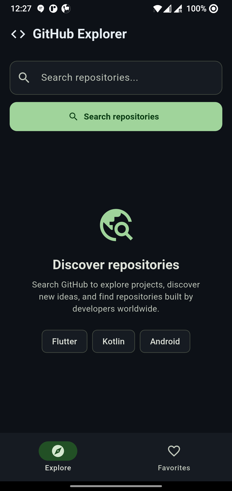
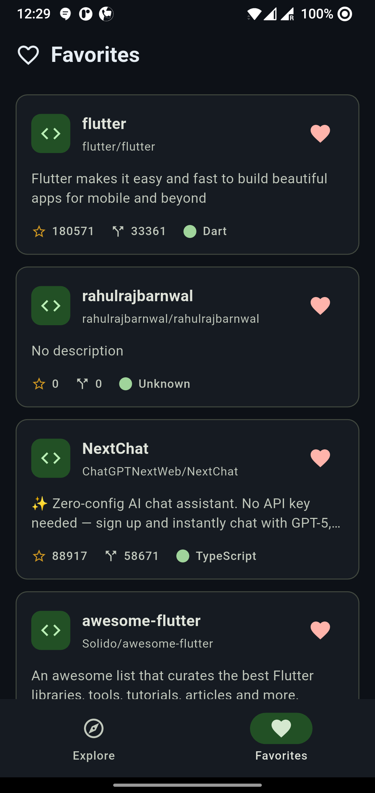
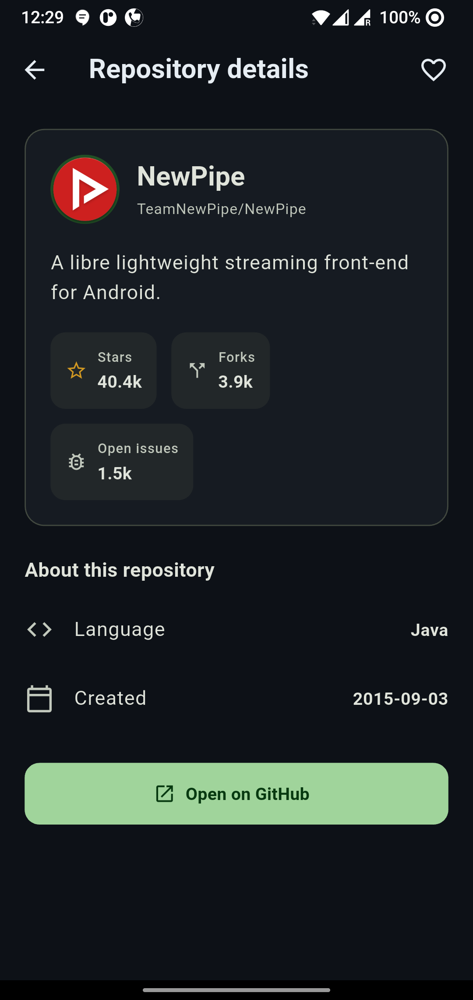

# GitHub Explorer 🚀


Built with **Flutter, Dart, Riverpod, and the GitHub REST API**, this project demonstrates API integration, state management, pagination, local persistence, and theme-aware UI design.

## 📱 Screenshots

Search for repositories or use quick-search suggestions to discover projects.



### Search Results

Browse repositories with descriptions, programming languages, stars, forks, and favorite controls.


### Favorites

Access your saved repositories in one place. Favorites persist locally between app sessions.



### Repository Details

View repository information, statistics, programming language, creation date, and open the repository on GitHub.



## ✨ Features

- **Repository Search** — Search GitHub repositories by keyword.
- **Pagination** — Load additional results while scrolling.
- **Repository Details** — View descriptions, stars, forks, open issues, language, and creation date.
- **Favorites** — Save and remove repositories from a persistent favorites list.
- **Local Persistence** — Store favorites using SharedPreferences.
- **Light & Dark Theme** — Follow the device's system theme.
- **Quick Search** — Start searches using suggested topics such as Flutter, Kotlin, and Android.
- **Open on GitHub** — Launch a repository in an external browser.
- **Error Handling** — Handle API errors and provide retry options for pagination.

## 🏗️ Project Structure

```text
lib/
├── main.dart
├── navigation/
│   └── main_navigation_screen.dart
├── screens/
│   ├── explore_screen.dart
│   ├── favorites_screen.dart
│   └── repository_detail_screen.dart
├── models/
│   └── github_repository.dart
├── providers/
│   ├── favorites_provider.dart
│   └── github_repositories_provider.dart
├── repositories/
│   └── github_repository_api.dart
└── widgets/
    └── repository_list.dart
```

### Architecture Overview

- **Screens:** Render the Explore, Favorites, and Repository Details interfaces.
- **Providers:** Manage repository search, pagination, loading/error states, and favorites.
- **Repository/API layer:** Communicates with the GitHub REST API.
- **Model:** Maps GitHub API responses into a `GitHubRepository` object.
- **Widgets:** Provide reusable UI components, including repository cards.

## 🚀 Getting Started

### Prerequisites

- Flutter SDK installed
- Dart SDK compatible with your Flutter installation
- Android Studio or VS Code with Flutter support
- An emulator or physical device

### Installation

1. Clone the repository:

   ```bash
   git clone https://github.com/rahulrajbarnwal/github-explorer-flutter.git
   ```

2. Navigate to the project directory:

   ```bash
   cd github-explorer-flutter
   ```

3. Install dependencies:

   ```bash
   flutter pub get
   ```

4. Run the application:

   ```bash
   flutter run
   ```

## 🔌 API

This application uses the GitHub REST API to search repositories and retrieve repository information.

Repository search endpoint:

```text
GET https://api.github.com/search/repositories?q={query}&page={page}&per_page={perPage}
```

GitHub may enforce API rate limits, particularly for unauthenticated requests.

## 🔮 Future Improvements

- Repository sorting and filtering
- Improved offline handling
- Automated unit and widget tests
- More detailed repository activity and contributor information

## 👨‍💻 Author

**Rahul Raj Barnwal**

Senior Android Engineer | Flutter Learner

- GitHub: [@rahulrajbarnwal](https://github.com/rahulrajbarnwal)
- LinkedIn: [Rahul Raj Barnwal](https://www.linkedin.com/in/rahul-raj-barnwal-6b1929105/)

---

If you find this project useful, consider giving it a ⭐ on GitHub!
